# Nativer Controller für den isolierten Snapshot-Piloten

Dieser Controller ergänzt den [Offline-Supervisor](CLOUDFLARE_SNAPSHOT_PILOT.md).
`wrangler.pilot.jsonc` beschreibt einen **eigenen** Worker, eine eigene SQLite-
Durable-Object-Namespace und eine Container-Anwendung mit `durable_object`-
Scheduling. Produktionsworker, Domains und bestehende Auth-State-Anbindung
werden nicht geändert. Das Manifest schaltet `workers_dev` und Preview-URLs aus
und enthält keine Routen. Es wird hier nichts deployt oder aktiviert.

## Zwei feste Instanzen, ein begrenzter Ablauf

Der Worker adressiert ausschließlich `source`; der Controller kann zusätzlich
die fest benannte `inspection`-Instanz ansprechen. Derselbe Durable-Object-Typ
prüft seine Rolle vor jeder nativen Start-/Restore-Methode. Andere Namen
erhalten weder Container-Start noch Inspector-RPC. Dies begrenzt diesen Pilot-
Code auf höchstens zwei Container; es ist keine globale Account-Kostenbegrenzung.

```mermaid
stateDiagram-v2
    [*] --> empty
    empty --> starting: Absicht dauerhaft speichern
    starting --> running: Fresh-Start und Readiness bestätigt
    running --> capturing: Aufnahmeabsicht dauerhaft speichern
    capturing --> captured: Quiesce, native Aufnahme, erneuter Root-Abgleich
    captured --> restoring: Pin, Image und Frist geprüft; Absicht speichern
    restoring --> staged: Zweite Instanz nur im Inspect-Modus
    starting --> blocked: Fehler oder ungewisses Ergebnis
    capturing --> blocked: Fehler oder ungewisses Ergebnis
    restoring --> blocked: Fehler oder ungewisses Ergebnis
```



Die Quelle bleibt nach Quiesce bestehen und hält die Root-Lease. Wiederherstellung
startet **eine andere Instanz**; es gibt keinen Destroy-/Overwrite-Aufruf für die
Quelle. Der Inspector nimmt pro Namespace genau einen Restore-Versuch an und
speichert seine Absicht ebenfalls vor dem nativen Start. Er überschreibt weder
eine bereits verwendete Zielinstanz noch eine laufende Instanz.

Der Controller ist bewusst ein einmaliger Wiederherstellungs-Pilot. Es gibt
keine Reset-, Resume-, Aktivierungs- oder Produktions-Proxy-Route. Ein weiterer
Versuch nach einem unklaren Zustand erfordert eine gesondert geprüfte neue
Pilotumgebung und darf nicht durch Zurücksetzen des Journals erzwungen werden.

## Zugriff und HTTP-Vertrag

Das Manifest deklariert nur den erforderlichen Secret-**Namen**
`TANKAI_PILOT_CONTROL_TOKEN`. Es erzeugt oder speichert keinen Secretwert. Ohne
gültigen Bearer-Token wird bereits vor dem Auflösen der Durable-Object-Bindung
mit 403 abgewiesen. Der Token muss 43–128 URL-sichere ASCII-Zeichen enthalten;
der Vergleich erfolgt zeitkonstant bei gleicher Bytezahl. Der DO prüft denselben
Zugriff erneut. Es gibt keinen CORS-Zugang und keine Query-Parameter für Objekt-
Namen, Image, Containerbefehle oder Snapshot-Handles.

| Methode und Pfad | Wirkung |
| --- | --- |
| `GET /_pilot/status` | Persistenter Zustand der Quelle; startet keinen Container |
| `GET /_pilot/inspection` | Persistenter Zustand des Inspectors; startet keinen Container |
| `POST /_pilot/start` | Einmaliger frischer Mock-Pilot; Body `{}` |
| `POST /_pilot/capture` | Geordnetes Quiesce und native Aufnahme; Body `{}` |
| `POST /_pilot/restore` | Gespeicherte Aufnahme auf zweite Instanz; Body `{"pin":"64-hex-sha256"}` |

POST verlangt außerdem `Content-Type: application/json`, einen UUID-v4-
`Idempotency-Key` und `If-Match: "REVISION"` gemäß dem ETag von `/status`.
Der Body ist auf 512 Bytes begrenzt; zusätzliche Felder werden abgewiesen.
Snapshot-IDs können nicht über den HTTP-Body eingeschleust werden und werden
in öffentlichen Statusantworten nicht ausgegeben.

Revisionen werden in einer synchronen SQLite-Transaktion verglichen und erhöht.
Nach der Absichtstransaktion wird `ctx.storage.sync()` ausdrücklich abgewartet,
bevor ein nativer Effekt oder ein Inspector-Auftrag ausgeführt wird. Ein Fehler
dieser Schreibbestätigung verhindert den Effekt. Dies verlässt sich nicht auf
eine implizite Kopplung nativer Methoden an HTTP-/RPC-Output-Gates.
Die letzte Operation speichert ID, Aktion und Restore-Pin. Ihre Wiederholung
liest den vorhandenen Zustand statt einen nativen Effekt erneut auszulösen.
Eine gleiche ID mit anderer Aktion oder anderem Pin wird abgewiesen; ältere
Operationen scheitern zusätzlich an Revision oder Phase.

Pending-Antworten tragen 202 und `automatic_resume=false`. Pending bedeutet
laufend **oder** unterbrochen, nicht automatisch fehlgeschlagen. Nach Verlust
des DO-Prozesses bleibt dieselbe persistente Absicht bestehen. Neue Effekte
werden dann nicht automatisch angestoßen. Bei einem Fehler wird `blocked`
gespeichert; fällt auch dieser Schreibvorgang aus, bleibt die vorher gespeicherte
Pending-Absicht als Sperre erhalten. Beide Statusrouten helfen bei der Prüfung
eines unklaren Restore-Ergebnisses, ohne etwas wieder zu starten.

## Bindung der aufgenommenen Daten

`ctx.container.images.base` muss eine Digest-gepinnte Referenz in
`registry.cloudflare.com/...@sha256:...` sein. Mutable Tags werden **vor** dem
Start abgewiesen. Der Dockerfile-Eintrag im Manifest dient zunächst dem Build;
die vom Zielsystem aufgelöste Referenz muss diese Bedingung ebenfalls erfüllen.
Falls nötig muss eine später genehmigte Pilotkonfiguration die bereits gebaute
Image-Version explizit mit ihrem Registry-Digest referenzieren.

Vor und nach der Aufnahme muss die native Source-Image-Inspektion mit dem
gespeicherten Image übereinstimmen. Die Aufnahme benötigt einen validierten
Supervisor-Receipt für `quiesced`, Exit/Kindprozess beendet, gehaltene Root-Lease
und Root-Digest. Nach der nativen Aufnahme wird der Receipt erneut gelesen;
Root-ID und Digest müssen übereinstimmen.

Die persistente Capsule enthält Generation, Image-Referenz, Root-ID, Root-Digest,
nativen Snapshot-Handle, Größe und Zeitfenster. Ihr SHA-256 bindet die feste
kanonische Darstellung aller Felder. Beim Restore muss der vom Betreiber
aufbewahrte Pin mit der gespeicherten Capsule und ihrem neu berechneten Hash
übereinstimmen. Das ist Inhaltsbindung, **kein** externer Freshness-/Anti-Rollback-
Nachweis. Ein bloßes erneutes Ablesen desselben Speichers schafft keine
unabhängige Aufbewahrung.

Dieser Pilot akzeptiert Aufnahmen nur innerhalb seines eigenen 24-Stunden-
Fensters; das ist eine konservative Anwendungspolicy, keine Zusage zur
Cloudflare-Aufbewahrung. Abgelaufene oder aus Sicht der aktuellen Uhr zukünftige
Capsules werden abgewiesen. Image-Wechsel verhindern den Restore, bevor die
Zielinstanz berührt wird.

Der native Restore startet mit `enableInternet:false`, `instance:"lite"` und dem
festen `inspect`-Entrypoint. Gemäß Container-API ist das native Image-Feld bei
einem Snapshot-Restore leer; es wird nicht als erneuter Image-Nachweis ausgegeben.
Der Controller prüft stattdessen den zuvor gebundenen Image-Pin, feste Start-
Labels und den tatsächlichen Inspect-Receipt mit passender Root-ID und Digest.

Native Exec-Aufrufe sind feste Argumentlisten ohne Shell, laufen mit UID/GID
`10001:10001` und haben eine begrenzte Ausgabe sowie einen eigenen Timeout.
Ein abgebrochener HTTP-Client löst keinen zweiten Quiesce-Aufruf aus. Das Töten
des Control-Clients bestätigt nicht das Ende des Supervisor-Ablaufs; ein
unklares Ergebnis bleibt deshalb gesperrt. Eine Idle-Frist von zehn Minuten
wird nach Start und bei DO-Neuinstanziierung eines laufenden Containers gesetzt.
Sie ist kein absoluter Laufzeit- oder Eurodeckel und kein automatischer Neustart.

## Lokale Prüfungen

```bash
npm ci --ignore-scripts
npm run cf:check
npm run pilot:check
npm run pilot:test
```

`pilot:check` generiert eigene Binding- und Runtime-Typen und prüft den Pilot
mit einer getrennten TypeScript-Konfiguration. So werden die generierten
`Cloudflare.GlobalProps` der beiden Worker nicht miteinander vermischt.
Der neueste vom gepinnten workerd unterstützte Kompatibilitätstag ist hier
`2026-10-07`; ein neueres Datum würde den lokalen Test-Worker nicht starten.
Wranglers Dry-Run baut bei dieser Konfiguration auch das Docker-Image und
kann deshalb für den Paketdownload Netzwerk benötigen; er deployt nicht.

Der Integrationslauf nutzt echten Miniflare-/workerd-SQLite-Speicher, echte
Worker-Authentifizierung und persistente Neustarts. Native Container-Effekte
werden ausschließlich im separaten Test-Entrypoint simuliert. Er prüft
Idempotenz/Konkurrenz, persistente Pending-/Fehlerzustände, Inhalts-Pins,
Zeitfenster, Image-Wechsel, Root-Änderungen sowie tatsächliche Start-/Exec-
Argumente des nativen Adapters. Der echte deploybare Worker wird zusätzlich
ohne Container-Bindung geprüft: Status funktioniert, Compute-Start wird
abgewiesen. Test-Routen und simulierte Handles dürfen nicht im Deploy-Artefakt
vorkommen; dies wird mitgeprüft. **Kein nativer Cloudflare-Snapshot ist damit
bereits als funktionierend nachgewiesen.**

## Noch offene Freigaben und Nachweise

Noch nicht ausgeführt sind Bereitstellung der getrennten Pilotressourcen,
Operator-Secret-Einrichtung, ein geschützter Zugang und ein echter nativer
Aufnahme-/Restore-Lauf auf Cloudflare. Vor einem solchen Lauf sind der konkrete
Image-Digest, Compute-Kostenrahmen und der Rückbau festzulegen. Production-Routing
und Provideraktivierung gehören nicht zu diesem Controller.

Der native Snapshot kopiert Dateien unverändert. Er widerruft keine darin
enthaltenen Sitzungen oder Agent-Tokens und validiert keine monetären Holds.
Deshalb bleibt die Kopie ausschließlich im Inspect-Modus. Für spätere echte
Daten gelten weiterhin die getrennten [Application-Checkpoint-Verträge](APPLICATION_CHECKPOINT.md),
einschließlich Credential-Widerruf, unbekannten Holds, alten Schreibern und
isolierten neuen Zielen. Eine Produktionsaktivierung ist nicht implementiert.

Quellen: [native API](https://developers.cloudflare.com/containers/api/durable-object-container/),
[Snapshots](https://developers.cloudflare.com/containers/guides/snapshots/),
[Scheduling-Migration](https://developers.cloudflare.com/containers/guides/migrate-to-durable-object-scheduling-policy/),
[SQLite-Durable-Object-Speicher](https://developers.cloudflare.com/durable-objects/api/sqlite-storage-api/).
